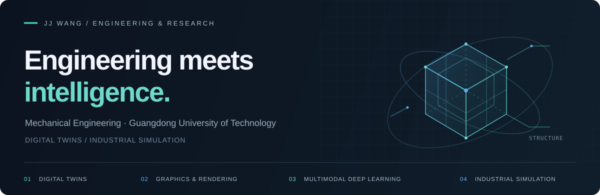

  

  <a href="#selected-work">Selected Work</a> &nbsp; / &nbsp;
  <a href="#focus">Focus</a> &nbsp; / &nbsp;
  <a href="https://github.com/13536309143?tab=repositories">All Repositories</a>

### Hi, I'm JJ Wang.

机械工程背景，来自广东工业大学。主要研究方向为**数字孪生、图形学渲染、多模态深度学习与工业仿真**，关注从模型、实验到工程实现的完整过程。

Mechanical engineering at Guangdong University of Technology. My research focuses on digital twins, computer graphics and rendering, multimodal deep learning, and industrial simulation.

 

<h2 id="selected-work">Selected Work</h2>

<table>
<tr>
<td width="50%" valign="top">
01 / INDUSTRIAL GRAPHICS
<h3><a href="https://github.com/13536309143/Industrial-Semantic-LOD">Industrial Semantic LOD ↗</a></h3>

工业三维模型的语义结构感知 LOD：连接零件级语义分析、局部几何保护与 GPU 驱动渲染。

C++ · Vulkan · PointNeXt · PointCLIP V2

</td>
<td width="50%" valign="top">
02 / INTELLIGENT MAINTENANCE
<h3><a href="https://github.com/13536309143/mera-phm">MERA-PHM ↗</a></h3>

融合维护事件与多模态证据的退化预测，结合预测区间、证据溯源与可审计的 Agent 协作。

Python · Multimodal Learning · Agent Tools

</td>
</tr>
<tr>
<td width="50%" valign="top">
03 / COMPUTER VISION
<h3><a href="https://github.com/13536309143/GlyphWeave">GlyphWeave · 字织 ↗</a></h3>

结合笔画梯度、层级卷积与空间注意力的手写字符识别，覆盖汉字、英文字母和数字共 7,247 类。

PyTorch · CNN · Spatial Attention

</td>
<td width="50%" valign="top">
04 / MULTIMODAL PROGNOSTICS
<h3><a href="https://github.com/13536309143/multi-branch-multimodal-prognostics">Multimodal Prognostics ↗</a></h3>

从信号图像、维护文本与数值历史预测下次检修的退化程度，提供多分支融合与来源隔离评估。

PyTorch · Feature Fusion · Grouped Evaluation

</td>
</tr>
</table>

 

<h2 id="focus">Focus</h2>

| Direction | What I explore |
| :--- | :--- |
| **Digital twins · 数字孪生** | 工业系统的数字化建模、状态映射与虚实交互 |
| **Graphics & rendering · 图形学渲染** | 工业三维可视化、语义与结构感知 LOD、GPU 驱动渲染 |
| **Multimodal deep learning · 多模态深度学习** | 图像、文本与数值信息融合，跨模态表征与设备退化预测 |
| **Industrial simulation · 工业仿真** | 工业场景与设备行为建模、仿真分析及可视化 |

 

  JJ WANG &nbsp; / &nbsp; MECHANICAL ENGINEERING &nbsp; / &nbsp; <a href="https://github.com/13536309143?tab=repositories">EXPLORE THE CODE ↗</a>

